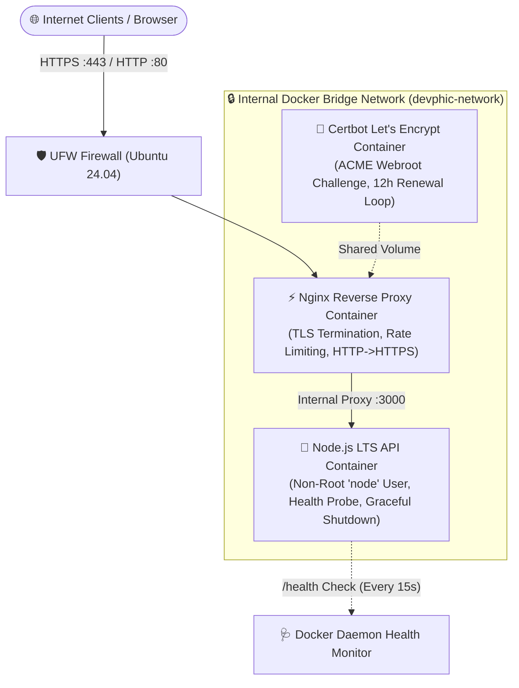

# Devphic VPS Starter — Open-Source Deployment Kit

[](https://nodejs.org/)
[](https://ubuntu.com/)
[](https://www.docker.com/)
[](https://nginx.org/)
[](https://letsencrypt.org/)
[](LICENSE)
[](.github/workflows/ci.yml)

> **Devphic VPS Starter** is a production-grade, minimal, and secure open-source deployment kit designed to help developers deploy Node.js applications to an **Ubuntu 24.04 VPS** with automated Nginx reverse proxying, Let's Encrypt HTTPS, UFW firewall hardening, and zero-downtime management scripts.

---

## Deploy to Hostinger

Click the button below to deploy your own Ubuntu 24.04 KVM VPS on Hostinger:

<!-- ======================================================================= -->
<!-- HOSTINGER OFFICIAL DEPLOYMENT BUTTON PLACEHOLDER                       -->
<!-- Replace the link below with your approved Hostinger partner/referral URL -->
<!-- ======================================================================= -->
[](https://hpanel.hostinger.com/)

*Note: The button above links to Hostinger's VPS management portal. For detailed step-by-step guidance on setting up an Ubuntu 24.04 VPS, SSH keys, and DNS records on Hostinger, see the [Hostinger VPS Deployment Guide](HOSTINGER_GUIDE.md).*

---

## Architecture Overview



### Key Engineering Decisions
- **Multi-Stage Docker Build:** Minimal runtime attack surface using `node:20-alpine`, dropping root privileges to `USER node` (UID 1000).
- **Internal Network Isolation:** Port `3000` is **never** exposed to the public host interface, preventing bypass of reverse proxy protections.
- **Automated TLS & Zero-Crash SSL Bootstrap:** Includes a bootstrap routine that generates a temporary self-signed certificate, starts Nginx, completes the Let's Encrypt ACME HTTP-01 challenge, installs genuine certificates, and reloads Nginx seamlessly.
- **Graceful Process Shutdown:** Actively tracks in-flight HTTP connections and intercepts `SIGTERM` / `SIGINT` signals, ensuring zero dropped requests during updates or restarts.

---

## Prerequisites

Before starting, ensure you have:
1. **VPS Instance:** Running **Ubuntu 24.04 LTS** (Hostinger KVM 1 or KVM 2 recommended, min. 1 vCPU, 1 GB RAM, 10 GB disk).
2. **Domain Name:** A registered domain (e.g. `api.yourdomain.com` or `yourdomain.com`).
3. **DNS A Record:** Configured with your DNS provider (e.g., Hostinger DNS Zone) pointing directly to your VPS public IPv4 address.
4. **Port Accessibility:** Inbound ports `22` (SSH), `80` (HTTP), and `443` (HTTPS) permitted by your cloud hosting firewall.

---

## Quickstart (Interactive 3-Step Setup)

Connect to your Ubuntu 24.04 VPS via SSH and run:

```bash
# Step 1: Clone the deployment kit
git clone https://github.com/devphic/devphic-vps-starter.git /opt/devphic-vps-starter
cd /opt/devphic-vps-starter

# Step 2: Make automation scripts executable
chmod +x scripts/*.sh

# Step 3: Run the interactive setup wizard
./scripts/setup.sh
```

### What `setup.sh` Automates:
1. **Validates OS & Resources:** Confirms Ubuntu 24.04 LTS, architecture, available RAM, and disk space.
2. **Installs Docker & Compose:** Installs the official Docker Engine and Compose plugin if missing.
3. **Interactive `.env` Wizard:** Prompts for your domain, admin email, CORS policy, and generates a cryptographically secure 32-byte secret key with safe `chmod 600` permissions.
4. **Pre-Flight DNS Check:** Resolves your domain against the server's public IP address to prevent Let's Encrypt challenge failures and rate limit penalties.
5. **Hardens UFW Firewall:** Restricts access strictly to SSH, HTTP (80), and HTTPS (443).
6. **Provisions Let's Encrypt SSL:** Deploys initial certificates and starts the background renewal agent.
7. **Configures Auto-Reload Cron:** Installs `/etc/cron.d/devphic-cert-reload` to reload Nginx daily.

---

## Manual Deployment Option

If you prefer to configure the deployment manually without the interactive wizard:

```bash
# 1. Copy and edit environment variables
cp .env.example .env
nano .env

# 2. Build and start containers in HTTP-only mode (or with pre-existing certs)
docker compose up -d --build

# 3. Issue Let's Encrypt certificate via Certbot
docker compose run --rm certbot certonly \
  --webroot \
  -w /var/www/certbot \
  -d yourdomain.com \
  --email admin@yourdomain.com \
  --agree-tos \
  --no-eff-email

# 4. Reload Nginx
docker compose exec nginx nginx -s reload
```

---

## API Reference

The sample Node.js API provides the following built-in endpoints:

| Method | Endpoint | Description | Sample Response / Status |
| :--- | :--- | :--- | :--- |
| `GET` | `/` | API status and service directory | `200 OK` (JSON) |
| `GET` | `/health` | Deep health probe (uptime, memory, platform, load) | `200 OK` (JSON) |
| `GET` | `/api/health` | Alias for `/health` probe | `200 OK` (JSON) |
| `GET` | `/api` | API documentation and available routes | `200 OK` (JSON) |
| `GET` | `/api/info` | Application features and runtime environment | `200 OK` (JSON) |
| `GET` | `/api/items` | Retrieve sample data collection | `200 OK` (JSON) |
| `POST` | `/api/items` | Create new item (validates JSON body) | `201 Created` / `400 Bad Request` |
| `GET` | `/api/error-test`| Trigger deliberate exception to verify error handling | `500 Internal Server Error` (Sanitized JSON) |

### Sample Health Check Response (`GET /health`)
```json
{
  "status": "healthy",
  "timestamp": "2026-10-22T17:40:17.225Z",
  "uptimeSeconds": 1420,
  "service": {
    "name": "Devphic VPS Starter API",
    "version": "1.0.0",
    "environment": "production",
    "nodeVersion": "v20.18.0"
  },
  "system": {
    "hostname": "893c5d6f1a0e",
    "platform": "linux",
    "arch": "x64",
    "loadAverage": [0.08, 0.05, 0.01],
    "freeMemoryMB": 820,
    "totalMemoryMB": 2048,
    "processMemoryMB": {
      "rss": 42,
      "heapUsed": 18,
      "heapTotal": 24
    }
  }
}
```

---

## Operations & Lifecycle Management

Devphic VPS Starter includes purpose-built operational scripts in the `scripts/` directory:

### 1. Safe Zero-Downtime Updates
Pulls the latest code from Git, creates a pre-update `.env` backup, rebuilds the application container, validates the health probe, and reloads Nginx:
```bash
./scripts/update.sh
```

### 2. Automated Backups & Rotation
Creates a compressed archive of `.env`, Nginx configurations, and Let's Encrypt certificates in `backups/`, keeping the last 7 backups:
```bash
./scripts/backup.sh
```

### 3. VPS Diagnostic & Troubleshooting
Inspects container statuses, memory usage, open ports, UFW rules, DNS resolution, SSL certificate expiration dates, and recent container logs:
```bash
./scripts/troubleshoot.sh
```

### 4. Safe Teardown & Uninstall
Stops containers and safely removes volumes and cron jobs with explicit confirmation prompts:
```bash
./scripts/uninstall.sh
```

---

## Common Troubleshooting Scenarios

### 1. Let's Encrypt ACME Challenge Fails
- **Cause:** DNS A record has not finished propagating, or port 80 is blocked by a cloud firewall.
- **Fix:** Run `./scripts/troubleshoot.sh` to check DNS resolution. Confirm your domain resolves to your server's public IP using `dig +short yourdomain.com`. Verify port 80 is allowed in UFW (`sudo ufw status`).

### 2. `502 Bad Gateway` from Nginx
- **Cause:** The Node.js application container is starting up or has failed health checks.
- **Fix:** Check container status and logs:
  ```bash
  docker compose ps
  docker compose logs --tail=50 app
  ```

### 3. Port Conflicts (`Address already in use: 80 or 443`)
- **Cause:** An existing Apache, Nginx, or standalone Certbot instance is already bound to port 80/443 on the host.
- **Fix:** Stop and disable host web servers:
  ```bash
  sudo systemctl stop apache2 nginx 2>/dev/null || true
  sudo systemctl disable apache2 nginx 2>/dev/null || true
  ```

---

## Security Best Practices Included

- **No Hardcoded Secrets:** All secrets, ports, and domains are loaded from `.env`.
- **Protected File Permissions:** The setup script automatically sets `chmod 600 .env`.
- **Security Headers:** Strict-Transport-Security (HSTS), X-Frame-Options, X-Content-Type-Options, Referrer-Policy, and Helmet protections enabled.
- **Rate Limiting:** Nginx restricts client requests to 20 req/s with a burst capacity of 40 to protect against brute-force attacks.
- **Log Rotation:** Docker JSON logging is capped at 10 MB per file (max 3 files) to prevent VPS disk exhaustion.

---

## Automated Testing & CI

Devphic VPS Starter includes unit and integration tests using Node's native test runner (`node:test`) and Supertest.

Run the test suite locally:
```bash
npm test
```

Tests run automatically on every push and pull request via [GitHub Actions](.github/workflows/ci.yml) against Node.js 20 and 22 on Ubuntu 24.04.

---

## Hostinger Open Source Program Checklist

This repository meets all requirements for Hostinger's VPS Application Catalog and Open Source partnership reviews:

- [x] **Permissive License:** Permissive OSI-approved [MIT License](LICENSE).
- [x] **Production Docker Stack:** Non-root `Dockerfile` and `docker-compose.yml` with healthchecks.
- [x] **Reverse Proxy & TLS:** Nginx reverse proxy with automated Let's Encrypt renewal.
- [x] **Idempotent Setup:** Safe, non-destructive `setup.sh` wizard with rollback and backup guards.
- [x] **Complete Documentation:** Includes prerequisites, architecture diagram, DNS instructions, updates, backups, and troubleshooting.
- [x] **Tested & Maintained:** Automated CI testing on Ubuntu 24.04 with zero vulnerabilities.

---

## License

This project is licensed under the terms of the [MIT License](LICENSE).
